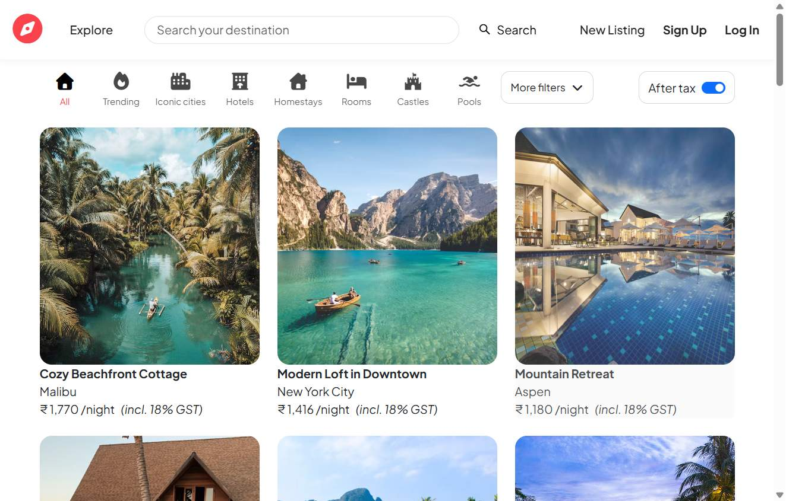
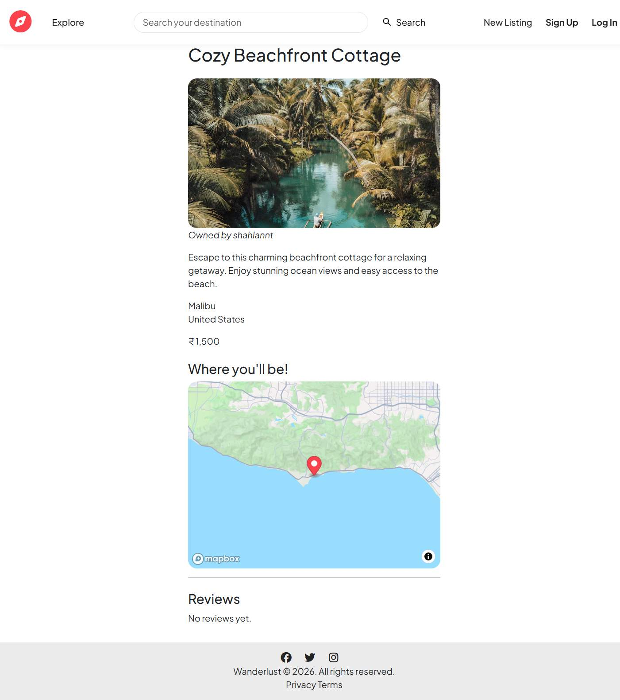

# Wanderlust

Wanderlust is a full-stack web application for discovering and sharing places to stay. Browse listings, search by location or country, filter by category, and view details, photos, maps, and guest reviews.

## Live Demo

[Visit Wanderlust](https://wanderlust-ghks.onrender.com)

## Screenshots

### Listings



### Listing details



## Features

- Browse listings and search by title, location, or country.
- Filter listings by category.
- View listing details, photos, map locations, and reviews.
- Create an account, log in, and log out.
- Create, edit, and delete listings when authorized.
- Add and delete reviews when authorized.
- Upload listing images to Cloudinary.
- View flash messages for successful actions and errors.

## Tech Stack

- **Server:** Node.js, Express
- **Templates and UI:** EJS, EJS-Mate, CSS, JavaScript
- **Database:** MongoDB with Mongoose
- **Authentication and sessions:** Passport, Express Session, Connect Mongo
- **Image storage:** Cloudinary with Multer
- **Maps and geocoding:** Mapbox
- **Validation:** Joi

## Requirements

- Node.js `24.19.0` (as specified in `package.json`)
- npm
- A MongoDB database
- Cloudinary credentials for image uploads
- A Mapbox access token for geocoding and map features

## Getting Started

1. Clone the repository and enter its directory:

   ```bash
   git clone <repository-url>
   cd wanderlust
   ```

2. Install dependencies:

   ```bash
   npm install
   ```

3. Create a `.env` file in the project root and set the required values:

   ```env
   ATLASDB_URL=<your-mongodb-connection-string>
   SECRET=<a-long-random-session-secret>
   CLOUD_NAME=<your-cloudinary-cloud-name>
   CLOUD_API_KEY=<your-cloudinary-api-key>
   API_SECRET=<your-cloudinary-api-secret>
   MAP_TOKEN=<your-mapbox-access-token>
   ```

   Keep `.env` private and never commit real credentials.

4. Start the application:

   ```bash
   node app.js
   ```

   The app connects to MongoDB and listens on port `8080`.

Open [http://localhost:8080](http://localhost:8080). The homepage redirects to `/listings`.

## Main Routes

| Path | Description |
| --- | --- |
| `/` | Redirects to `/listings` |
| `/listings` | Browse, search, and filter listings |
| `/listings/new` | Create a listing (login required) |
| `/listings/:id` | View a listing and its reviews |
| `/signup` | Create an account |
| `/login` | Log in |
| `/logout` | Log out |

## Notes

- Listing creation and editing use Mapbox geocoding to look up coordinates.
- Listing photos are stored in Cloudinary.
- The npm test script is currently a placeholder and does not run an automated test suite.
